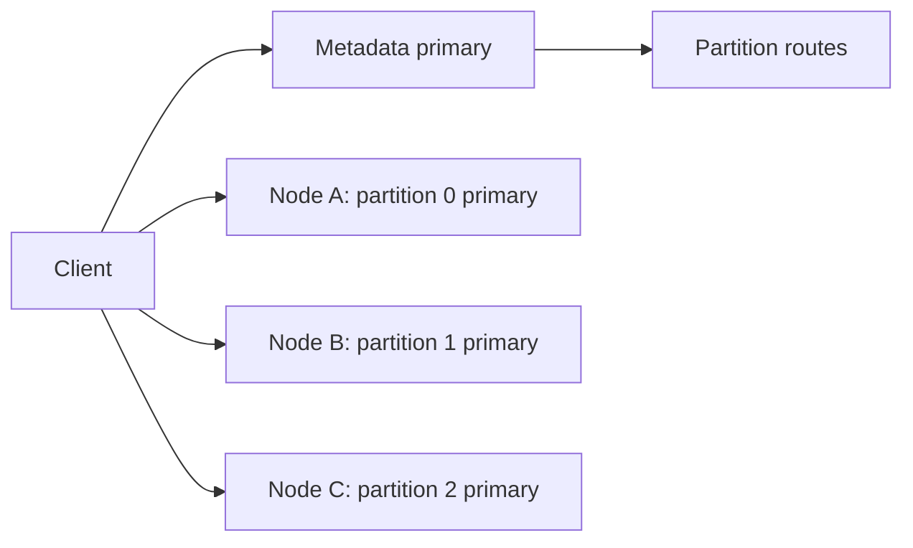

# Multi-Leader Partitions

> How partition primaries, replication factors and client routing distribute work across Iggy nodes.

Rendered page: https://iggy.apache.org/docs/clustering/multi-leader/

Source: https://github.com/apache/iggy-website/blob/main/content/docs/clustering/multi-leader.mdx

Docs version: server 0.10.0, Rust SDK 0.12.0, CLI 0.15.0, Node.js SDK 0.11.0, Python, Java, Go and C# SDKs 0.10.0, Swift, C++ and PHP SDKs 0.2.0

A primary orders writes for one consensus group. Iggy has one metadata group and a separate group for each partition. Multi-leader partitions let different nodes lead different partitions at the same time.

## Place partition primaries

New partitions spread their primaries across eligible nodes. The metadata primary also rebalances existing primaries one at a time. This restores the distribution after changes such as a failed node returning. Each partition still has one primary at a time, and its messages retain a partition-local order.



Metadata leadership does not tell a client where every message write belongs. Clients discover a partition's current primary and send partition requests there. A route also identifies the partition's history and ownership generation, so an old request cannot act on a replacement partition.

## Select copies per topic

`replication_factor` selects how many nodes store each partition of a topic. The value is fixed at topic creation. It must be from 1 through 32 and no greater than the cluster node count.

When the request omits it, `cluster.default_replication_factor` applies. Its default is `all`. The metadata group always uses the full cluster roster. A topic with fewer copies does not reduce the metadata quorum requirement.

```toml
[cluster]
default_replication_factor = 3
```

This configuration requires at least three cluster nodes. A topic can override it at creation. Increasing the number of partitions does not change the factor.

A factor of one provides no replica redundancy. A factor of two stops writes when either copy is unavailable. With three copies, the partition can tolerate one unavailable replica. See [Durability](https://iggy.apache.org/docs/clustering/durability) for the quorum rules and persistence policies.

## Route clients

Rust, Go, Java, C# and Node.js have native partition routing. Python, C++ and PHP use the Rust SDK through bindings. Swift has its own TCP client. Follow the individual [SDK guides](https://iggy.apache.org/docs/sdk/introduction) for supported recovery operations.

HTTP can forward a request to the correct primary in one hop. It needs the cluster authentication and shared JWT configuration described in [Security](https://iggy.apache.org/docs/clustering/security). Keep clocks synchronized because forwarding proofs expire after ten seconds.

## Operate the cluster

Every node must run the same server version and the same `cluster.coordinator.replica_connections_per_peer`. There is no rolling upgrade between 0.9 and 0.10. The roster supports at most 32 nodes.

More replica connections per peer can spread replication traffic across shards. This does not change the replication factor or quorum. Retain separate data directories for nodes and advertise addresses reachable by clients.
